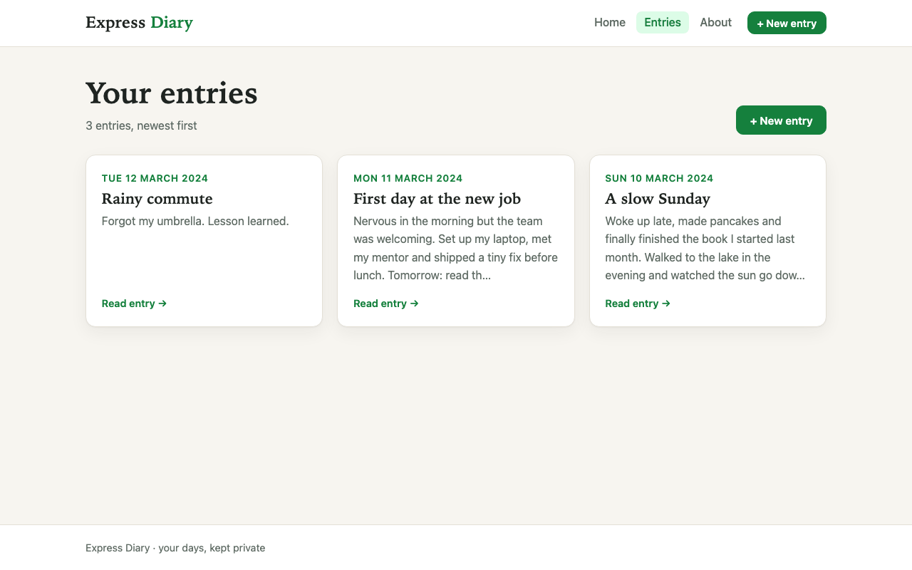
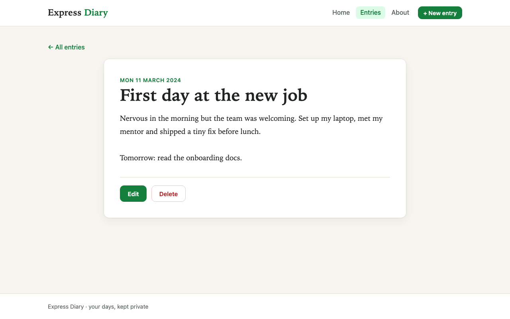
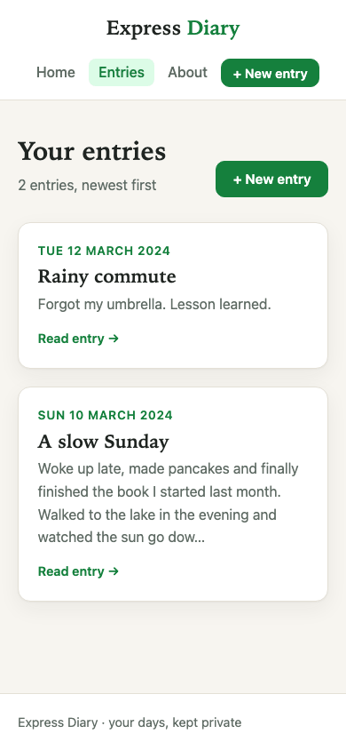

# Express Diary

A server-rendered personal diary built with Express, EJS and MongoDB. You can write, read, edit and delete dated entries.




| Entry | Mobile |
| ----- | ------ |
|  |  |

## Overview

Express Diary is a small backend-focused project for keeping a personal record of thoughts, feelings and events. Express renders every page on the server with EJS templates, and Mongoose stores the entries in MongoDB. HTML forms send `PUT` and `DELETE` requests through `method-override`.

The diary is private: every page is behind HTTP Basic authentication with a username and password you set in the environment.

## Features

- Add a diary entry with a title, a date (defaults to today) and the text.
- List all entries as cards, newest first, with a short excerpt.
- Open a single entry on its own page, edit it (the form is pre-filled, including the date) or delete it after a confirmation.
- Form validation with clear error messages, an empty state when there are no entries, and friendly 404 and error pages.
- Responsive layout with a shared header, navbar and footer.

## Tech stack

- Node.js 18+, Express 4
- EJS templates
- MongoDB with Mongoose 6
- method-override, dotenv; nodemon for development
- Tests with the built-in `node:test` runner

## Project structure

```
diary/
├── app.js            # Express app (createApp), routes and startup
├── lib/
│   ├── auth.js       # HTTP Basic auth + same-origin check for form posts
│   └── config.js     # environment variables
├── models/Diary.js   # title, description, date
├── public/           # style.css, favicon.svg
├── test/             # node:test tests (no database needed)
└── views/            # Home, about, Diary (list), page (detail), add, edit, 404, error, layout/ partials
```

## Getting started

### Prerequisites

- Node.js 18 or later and npm
- A MongoDB database (local or MongoDB Atlas)

### Install and run

```bash
git clone https://github.com/VamsiKrishnaThota03/diary.git
cd diary
npm install
cp .env.example .env   # then set MONGO_URI, DIARY_USERNAME and DIARY_PASSWORD
npm run dev            # or: npm start
```

Open http://localhost:3000 and sign in with the username and password from `.env`.

Run the tests with `npm test`.

### Environment variables

| Variable         | Required | Description                                                         |
| ---------------- | -------- | ------------------------------------------------------------------- |
| `MONGO_URI`      | yes      | MongoDB connection string, e.g. `mongodb://127.0.0.1:27017/diary`   |
| `DIARY_USERNAME` | yes      | Username for the diary login                                         |
| `DIARY_PASSWORD` | yes      | Password for the diary login (use a long, unique one)                |
| `PORT`           | no       | Port to listen on (default `3000`)                                   |
| `HOST`           | no       | Bind address (default `127.0.0.1`; set `0.0.0.0` on Render or similar hosts) |

The app exits at startup if a required variable is missing.

## Routes

All routes require the diary login.

| Method | Path               | Purpose                                         |
| ------ | ------------------ | ----------------------------------------------- |
| GET    | `/`                | Home page                                       |
| GET    | `/about`           | About page                                      |
| GET    | `/diary`           | List all entries                                |
| GET    | `/add`             | Form to add an entry                            |
| POST   | `/add-to-diary`    | Save a new entry, then open it                  |
| GET    | `/diary/:id`       | View a single entry                             |
| GET    | `/diary/edit/:id`  | Edit form                                       |
| PUT    | `/diary/edit/:id`  | Update an entry (sent as `POST ?_method=PUT`)   |
| DELETE | `/diary/:id`       | Delete an entry (sent as `POST ?_method=DELETE`) |

## Known limitations

- Single user only: there is one login, configured through the environment, and no sign-up.
- HTTP Basic auth sends the password with every request, so only deploy behind HTTPS (Render and similar hosts provide it).
- No search or pagination on the entries list.
